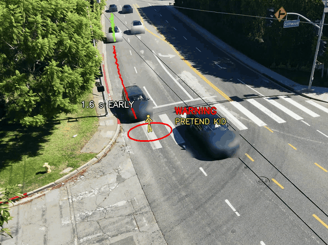
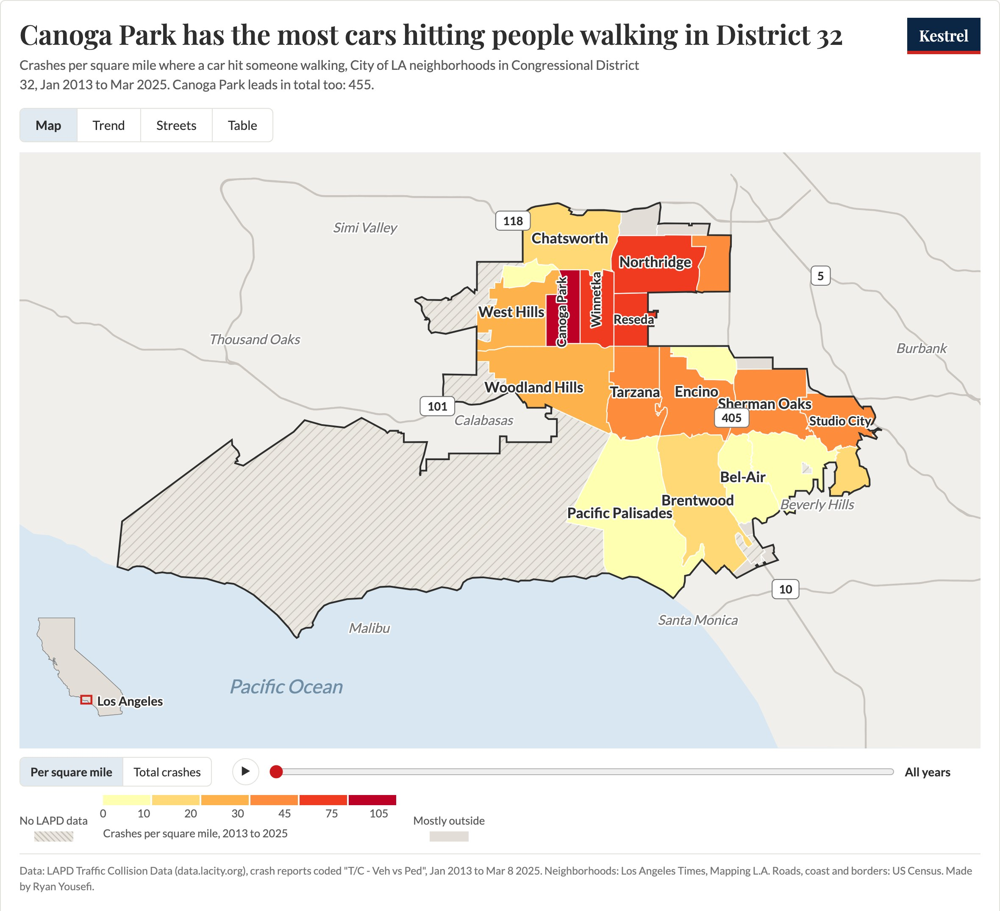

<picture><source media="(prefers-color-scheme: dark)" srcset="media/kestrel-logo-white.png"></picture>

# Kestrel

by Ryan Yousefi, for the 2026 Congressional App Challenge (California District 32)

Kestrel is a camera that guesses where a car is going and warns kids before it gets there.

Why I built it: in the City of LA part of my district, crashes that killed or badly hurt someone walking went from 61 in 2019 to 115 in 2024 (LAPD crash reports). Explore the numbers on my website, the Crash Atlas: https://kestrel-crash-atlas.vercel.app

## What Kestrel is

Kestrel is a camera that watches a toy road from above. When a toy car comes down the road, Kestrel guesses where the car is going. If the car is headed into a protected circle of LEGO kids, Kestrel acts before the car gets there: it turns a red light on for the driver, honks for the kid, and drops a gate across the road. If the car is going to miss the kids, Kestrel leaves it alone. That second half matters, because it shows Kestrel is guessing ahead and not just reacting to anything that moves.

The camera sits on a Mac. The Mac runs the Python program, and a small ESP32 board moves the two gate arms and the light.

## What I did

- **The idea.** Once, getting dropped off at a bus stop, I couldn't see a car coming from behind the bus and almost got hit. My bus driver honked. Kestrel is that honk, made automatic, for kids at bus stops and school pickup lines.
- **The design.** A gate that drops across the road like a parking-lot exit arm. A warning mode for places a gate can't go: a red light that faces the driver and a honk for the kid. Two gate arms that close from both sides. And my rule: any car headed through the gate drops the arms.
- **The build.** I built the test road and the machine: the white board road, the ramp, the LEGO kids, the two gate arms, the traffic light, the webcam hung above looking straight down, and the wiring from the motors and the light to the ESP32 board (Claude walked me through the wires one at a time). I found all four gate angles myself.
- **The decision code.** I typed `ryan_code.py` line by line. It is the part that decides:
  1. Is the car inside the circle right now?
  2. Where is the car going? I measure speed from 5 spots back instead of 1, because every spot has a small error and looking further back keeps the speed steady.
  3. Drop now or wait? I tried a safety margin of 0.2 seconds, then 0.4, and the gate still looked late, so I went to 1.0 second.
  4. How close did a car that missed come?

  Every other file only asks `ryan_code.py`. None of them work out where the car is going or whether it is in the circle.
- **Teaching it my car.** A ready-made AI couldn't find my toy car from above, so I retrained one on 240 photos of my car and 90 of the empty board.
- **The test.** I set the rule before rolling, then ran and filmed 20 rolls on the real road (results below).
- **The map and the website.** I picked what they show: every time a car hit someone walking in the City of LA part of District 32, from LAPD's public crash reports.
- **The video.** I filmed the test and myself, and the narration is my own voice.

## The test

I rolled the real toy car 20 times on the real road, using my code. Before counting, I set the rule: the first 10 rolls aimed at the kids and the first 10 aimed to miss, and every failure stays in the count.

- Kids saved: 10 of 10. Every time, the gate came down and stopped the car.
- Misses left alone: 9 of 10. Kestrel kept the gate up and showed how close the car came.
- The 10th miss does not count as a win. Kestrel saw the car once, lost it while it was moving, and only found it again after it stopped. The gate stayed up, but only because Kestrel lost the car, not because it guessed right.

**Street test (Oct 24 2026).** I passed the FAA's TRUST drone safety test and filmed 10 minutes of real traffic at a crosswalk from above. My decision code ran unchanged: it was tuned on the first 4 minutes and graded once on the last 6, which it had never seen. It found 59 of the 63 cars counted crossing, and with a pretend kid placed on real traffic in the crosswalk, it warned for all 24 cars that drove through the kid's spot, every one at least a full second early. The footage stays private. The test code is in `street/`.

## AI help

I used AI, and here is exactly where. Claude is Anthropic's AI.

- **Written by Claude:** the support code around my decision code (finding the car on camera, remembering its path, the screen, the log, the honk, moving the board's motors and light, the practice road, the self-tests, and the code that trains the car finder), the code that draws my map and website, and this README, from my notes.
- **In the video:** Claude helped word my script from my own words and edited the video. Higgsfield made the reenactments and the bus idea shot (both labeled AI on screen), ElevenLabs the music and sound effects, ChatGPT the logo, and Whisper the captions.
- **Outside tools Kestrel uses:** OpenCV, Ultralytics YOLO26, PyTorch, ONNX Runtime and pyserial.

The full, detailed list of every way I used AI is in [AI-USE.md](AI-USE.md).

## What each file does

- `kestrel_brain.py`: the main program. It finds the car, remembers where it has been, asks my code what to do, moves the gate and light, honks, and draws the screen.
- `ryan_code.py`: my code. It decides if the car is in the circle, guesses where the car is going, decides when to drop the gate, and works out how close a missing car came.
- `learn_car.py`: teaches Kestrel what my exact toy car looks like, then tests that it learned it before using it.
- `fake_road.py`: a pretend road on the screen, with a pretend car and board, so you can try Kestrel with no camera or board.
- `sims.py`: runs 20 pretend rolls to score my code, checks how fast is too fast, and has a self-test that checks every part.
- `gate_panel.py`: two sliders that turn each gate arm by hand, for testing.
- `firmware/kestrel_board/kestrel_board.ino`: the code on the ESP32 board. It started as the board code for an earlier project of mine, and Kestrel adds the gate and light lines to it. The parts of the old project Kestrel never uses are removed from this public copy.
- `models/my_car.onnx` and `models/my_car.json`: the trained car finder for my real toy car, and how sure it has to be before it counts something as the car.
- `models/practice_car.onnx` and `models/practice_car.json`: the same thing, trained on the pretend road.
- `sounds/honk.wav`: the honk. If it is missing, Kestrel makes a new one by itself.
- `settings.json`: the numbers for my own setup, like where the circle sits in the camera picture and how far each gate arm turns. On a new setup you place the circle again with the C key.
- `requirements.txt`: the Python add-ons Kestrel needs.
- `map/district-32-crash-atlas.jpg`: a picture of my Crash Atlas website's map (at the top).
- `website/index.html`: the Crash Atlas website, the same page that is live at the link below.

## How to run it

You need a Mac with Python 3.12 (Kestrel uses the Mac's own tools to play the honk and keep the screen awake). To try it with no camera and no board, use the pretend road.

1. Download this folder and open a terminal inside it.
2. Make a clean space for Kestrel's add-ons: `python3 -m venv .venv`
3. Put the add-ons in: `.venv/bin/pip install -r requirements.txt` (this takes a few minutes, because the AI part is big).
4. Try the pretend road: `.venv/bin/python kestrel_brain.py --practice`
   On the pretend road, press H to roll a car at the kids, M to roll one that just misses, F for a fast one, and Q to quit.
5. Score my code on 20 pretend rolls: `.venv/bin/python sims.py`
6. Check that every part works: `.venv/bin/python sims.py --selftest`

With the real setup (a webcam looking down at the road and the ESP32 board plugged in), run `.venv/bin/python kestrel_brain.py`. If it picks the wrong camera, run `.venv/bin/python kestrel_brain.py --find-camera` to save one picture from each camera, then add `--camera 1` (or whichever number is right). Press C to place the protected circle, and SPACE drops or lifts the gate by hand.
